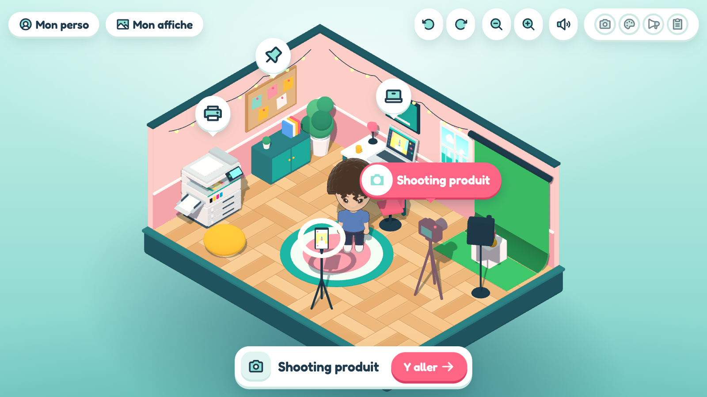

# Mini Future Me

[Version française](README.fr.md)

A 3D game for booths at career fairs. Each visitor becomes a small avatar (made from their photos or
by hand), does a few tasks of a trade in an isometric 3D room (an office, a workshop, a front desk…),
then leaves with a poster of their
avatar, printed or on their phone through a QR code. A game takes about 5 minutes and plays with a
mouse or a finger.

The game is built for several **trades**. Each one brings its tasks, its domains of the job, its work
stations and the object the avatar holds on the poster. One trade exists so far:

| Trade | Name in the game | What you do |
|---|---|---|
| Media technology (médiamaticien·ne, Swiss federal VET diploma) | **Mini Future Me Médiamaticien·ne** | a campaign for the "Pétille" lemonade: product shoot, photo retouch, poster layout, publishing, printing; the avatar holds the poster it laid out |

The game is meant for **short, simple demos**: in a few minutes, visitors try a few gestures of a trade,
without trying to show everything. It suits best the trades practised indoors, or whose work partly fits in
a single room. But the real limit is imagination.

The game's interface is in French (it was made for French-speaking Switzerland). Everything runs offline
on a single PC: the game stores no image of a face and sends none off the PC, and the booth team erases
the photos after each visitor (see [Visitors' photos](#visitors-photos)).



## Your trade in the game?

The game is made to welcome other trades. Some fit it especially well:

- **office trades**: commerce, administration, logistics, front desk;
- **IT trades**: software development, networks, support;
- **workshop trades**: technical, electronics, precision mechanics, crafts;
- **creative trades**: media, graphic design, design, fashion;
- **reception, care and service trades** practised in one room: a practice, a lab, a kitchen, a salon.

And many more: a trade practised outdoors or on a building site often has a workshop corner, tools or some
preparation to show. Each trade keeps the same look and the same flow, with its room, its own tasks, its
decor and the object the avatar holds on its poster.

- **Build it yourself**: follow the [Adding a trade](docs/adding-a-trade.md) guide. If you work with an AI
  assistant, the [`new-trade`](.agents/skills/new-trade/SKILL.md) skill gives it the art direction and the
  rules of the game, so the new trade looks like the others without starting from scratch.
- **Hand it over**: if your school would rather not take it on, the game's creator can build the trade
  with you, on quotation. Describe your project in a ["New trade" request](https://github.com/proprioz/mini-future-me/issues/new?template=nouvelle-filiere.yml) or get in touch through
  [the creator's GitHub profile](https://github.com/proprioz).

## Running the game

You need [Node.js](https://nodejs.org) 22.18 or newer and [pnpm](https://pnpm.io) (only have npm?
`npm install -g pnpm` once). To work on the code, start with [CONTRIBUTING.md](CONTRIBUTING.md).

At the booth:

```bash
pnpm install
cp .env.example .env.local    # then set your trades and your school (see Configuration)
WIFI_NAME="Mini-Future-Me" pnpm start
```

Then open http://localhost:3000 on the PC. `pnpm start` builds the game and starts the booth server
(`server/index.ts`), which serves the game and receives the posters. Each poster's QR code points to
`http://<PC's IP>:3000/p/<id>`: the phone must be on the same Wi-Fi (a router dedicated to the booth,
without Internet, is enough).

- Posters stay **in memory only** (nothing is written to disk) and are erased after 30 minutes, or when
  the server stops.
- From the Wi-Fi, phones can only reach their own poster (`/p/<id>`). The game and the poster upload
  only answer the PC itself (`localhost`).
- On the first run, the firewall (Windows or macOS) asks to allow Node: accept for the **private
  network**, or phones can't reach the PC.
- On Windows (PowerShell): `$env:WIFI_NAME="Mini-Future-Me"; pnpm start`.
- Server variables: `PORT` (3000), `WIFI_NAME` (shown next to the QR code), `PUBLIC_HOST` (address to put
  in the QR code when the IP detection gets it wrong), `POSTER_TTL_MINUTES` (30).

`pnpm install` also copies MediaPipe's WASM runtime and the small age/gender model into `public/`; the
`public/mediapipe/*.task|.tflite` models are versioned. The photo analysis therefore works without Internet.

## Configuration

Each booth's settings go in `.env.local` (ignored by git; template in `.env.example`):

| Variable | What it does |
|---|---|
| `VITE_TRADES` | trades offered on the welcome screen, in order (ids from `src/trades/index.ts`, comma-separated). Empty: all of them. With a single trade, the welcome screen offers no choice. |
| `VITE_SCAN` | `false`: no photo scan, the avatar is created by hand (no consent card). On by default; a trade can also turn it off for itself (`scan: false`). |
| `VITE_SCHOOL_NAME`, `VITE_SCHOOL_SITE`, `VITE_SCHOOL_URL` | your school, in the footer of every poster and of the printed "Dans les coulisses" (name, website shown, QR code link). Without a URL, there is no school block. |

The school's logo goes in `public/school/logo.svg` (ignored by git); when it is missing, its name is
written instead. In development, `?filiere=<id>` in the URL forces a trade.

## Kiosk mode

At the booth, open the game full screen in the browser, without an address bar, for example:

```bash
msedge --kiosk http://localhost:3000 --edge-kiosk-type=fullscreen --no-first-run
```

- **Welcome**: a random avatar waves until someone touches the screen. With several trades, a card
  offers to choose one. Then, when the scan is on, a card explains what the photos are used for ("Avec
  mes photos" or "Sans photos, à la main"); otherwise the game goes straight to "Crée ton perso".
- **Behind the scenes**: "Comment ce jeu est fabriqué", under the Play button, explains the game in
  chapters (code, 3D, face, scan, privacy, AI, then the job of each trade), with small demos on the
  welcome avatar. Made for the booth team to explain it, even without knowing the code. "Imprimer" lays every chapter out on a
  few A4 pages. In the privacy chapter, "Imprimer la fiche du stand" prints "Tes données sur ce stand", an
  A4 page to lay on the booth's table: what the game does with the visitor's data, from the photos to the
  poster. Texts in `src/ui/AboutPanel.ts`, and in each trade's `about.ts`.
- **Photos**: one front photo is enough; both profiles and the back can be added (1 to 4 photos), sorted
  into their slot automatically from the face they show. How to take and erase them:
  [Visitors' photos](#visitors-photos).
- **Inactivity**: after 60 s without a touch, "Tu es encore là ?" with a 10 s countdown, then back to the
  welcome screen. More time while choosing and analysing photos, and on the poster card (3 min, to scan
  the QR code).
- **End of game**: "J'ai fini !" on the poster card (two taps).
- **Reset**: the page reloads, so everything is forgotten (avatar, first name, domains won, scan
  measurements). Posters already sent stay on the server until they are erased (30 min).
- **For the team**: 5 quick taps in the top-left corner (or F5) reset the game. The sound button
  (welcome and office) mutes the sounds; the choice is remembered on the PC.
- To try on site: add `--kiosk-printing` to print straight to the default printer, without the print
  dialog.

## Visitors' photos

The game reads the photos, analyses them in memory and forgets them as soon as the scan screen is left.
But for the visitor to pick them, they must first be files on the PC: the booth team takes them, puts them
on the PC, then erases them, on the PC as well as on the device that took them.

**Preparing the PC** (once):

- A Windows or macOS account kept for the booth, without administrator rights, without personal files
  and with no session open (mail, cloud, browser): the file picker opens in front of the visitor and lets
  them browse this account.
- A single folder for the photos, for example "Photos du stand" on the desktop, outside any folder synced
  with a cloud. Pick it on the first try: the browser usually opens it again afterwards.

**For each visitor**:

1. Take the photos with the team's phone or the booth's camera (from the front and, if wanted, both
   profiles and the back).
2. Put them in the photo folder, empty until then (by cable, SD card or wireless sharing; if the transfer
   drops them in Downloads, move them).
3. The visitor picks them in the game. Someone from the team stays nearby while the file picker is open.
4. As soon as the analysis is over, erase the photos for good:
   - on the PC, without going through the bin: Shift + Delete on Windows, Option + Cmd + Backspace on
     macOS;
   - on the phone, then in the "Recently Deleted" album, which otherwise keeps them for 30 days;
   - on the camera, from its menu.

**At the end of the day**: check that the photo folder, Downloads and the PC's bin are empty, as well as
the phone's gallery and "Recently Deleted"; format the camera's card. Posters leave no file on the PC: at
the booth, they leave by QR code or on paper (the PNG and PDF buttons only exist in development).

## Development

```bash
pnpm dev      # the game on http://localhost:5173
pnpm server   # the booth server (Vite forwards /api to it), restarted on every change
```

Without `pnpm server`, everything works except the QR code (the export card then offers printing and
files). In development, inactivity is off (it would reload the page under the devtools): open
http://localhost:5173/?borne to test it.

To contribute, read [CONTRIBUTING.md](CONTRIBUTING.md); to add a trade,
[docs/adding-a-trade.md](docs/adding-a-trade.md). The full plan and design decisions are in [PLAN.md](PLAN.md).

Other commands:

| Command | What it does |
|---|---|
| `pnpm build` | builds the game into `dist/` |
| `pnpm check` | everything the CI checks: `pnpm typecheck` (TypeScript), `pnpm lint:css` (sizes in rem), `pnpm test` (rules of the game, contract of the trades), `pnpm test:e2e` (a whole visit of every trade in Edge, offline; without Edge, see CONTRIBUTING.md) |
| `pnpm icons` | regenerates the pictograms (`src/ui/iconPaths.ts`) after adding a name in `tools/build-icons.ts` |
| `pnpm profils` | regenerates `docs/profils-types.md`, the most likely look by gender and age |
| `pnpm portraits`, `pnpm apercu` | compare the scan with test portraits (see below) |

## Structure

```
server/                   booth server (Express): built game, poster upload, phone pages
src/
  main.ts                 entry point: welcome (trade choice), photos, "Crée ton perso", office, poster
  trades/                 the trades
    index.ts              registry: id, title, job, pictogram; VITE_TRADES and ?filiere
    types.ts              the contract of a trade, typed
    current.ts            the trade being played (trade())
    mediamatique/         media technology: tasks, domains, office stations, held poster, texts, mini-games
  game/                   common: isometric office (Room.ts), game loop (Game.ts), A* grid, input, domains (skills.ts)
  minigames/MiniGame.ts   common base of the mini-games: a card over the office, win or "Réessayer"
  character/              procedural chibi avatar: body, head, drawn face, hair, beards, accessories,
                          options and frequencies (population.ts), poster poses
  scan/                   photo analysis (MediaPipe, local age/gender model) → closest options
  poster/                 the A4 poster: decors, rendering, unlocks, school, exports
  kiosk/                  kiosk mode: inactivity, reset, sounds
  render/                 toon materials, palette, avatar stage, thumbnails
  ui/                     screens and HUD (welcome, scan, avatar creator, poster studio, behind the scenes…)
tests/                    unit/ (Vitest: rules of the game, trades' contract), e2e/ (Playwright: the game in a browser)
tools/                    pictograms, CSS rule, typical looks, test portrait comparison
docs/                     adding a trade, typical looks, scan log
```

## Test portraits

`pnpm portraits` compares the avatar the scan builds with test photos, from 4 angles, and opens a gallery
(`.playwright-mcp/comparaisons/index.html`) with the differences from the ground truth
(`tools/playwright/portraits.ts`). `pnpm apercu` draws the avatar described by each person's sheet. The
photos **are not in the repository**: put your own in `public/portraits/` (format in
[public/portraits/README.txt](public/portraits/README.txt)), only of fictional people or of people who gave
their consent. The ground truth and the log (`docs/portraits-journal.md`, in French) describe the author's
own set of portraits.

In development, `window.studio` exposes `welcome`, `scan`, `creator`, `kiosk`, `trades`, then `game` and
`posterStudio` once the game has started, to drive the game from the console or a test tool.
`studio.game.openTask('shoot')` opens a mini-game directly. The scripts in `tools/playwright/` (`upload.ts`,
`measure.ts`, `sheet.ts`, `simulate.ts`…) are imported from the page.

## License

The code is licensed under the [GPL-3.0-or-later](LICENSE): you may use, study, change and share it, as
long as your versions keep the same license.

Third-party parts included or bundled, each under its own license (all compatible):

| Part | License |
|---|---|
| Google's MediaPipe models (`public/mediapipe/`) and `@mediapipe/tasks-vision` | Apache-2.0 |
| Age/gender model of `@vladmandic/face-api` (copied by `pnpm install`) | MIT |
| [Phosphor](https://phosphoricons.com) pictograms (`src/ui/iconPaths.ts`) | MIT |
| Fredoka and Nunito fonts (`@fontsource-variable`) | SIL Open Font License 1.1 |
| three.js, jsPDF, qrcode, Express | MIT |

Your school's name and logo are not part of the repository (see Configuration).
